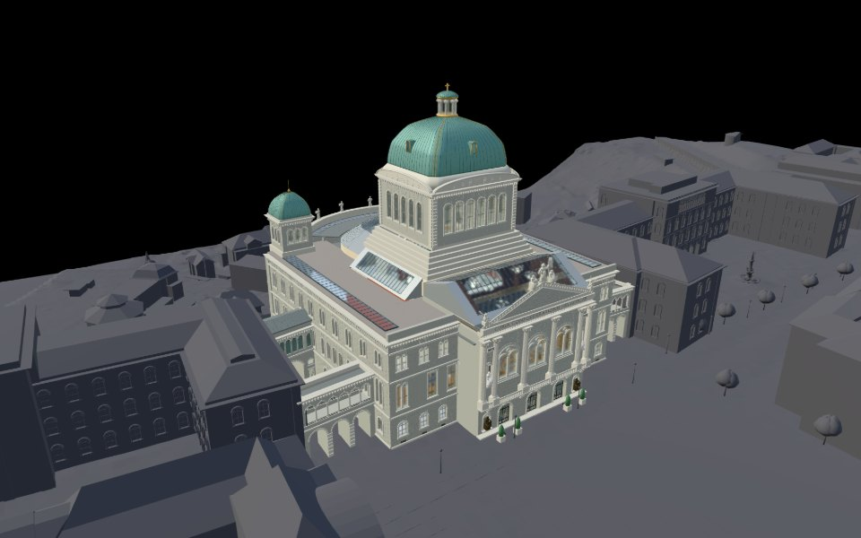
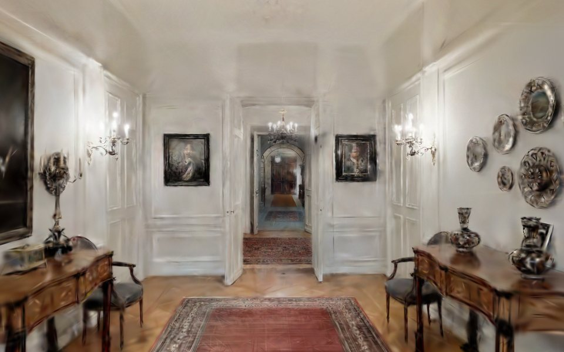
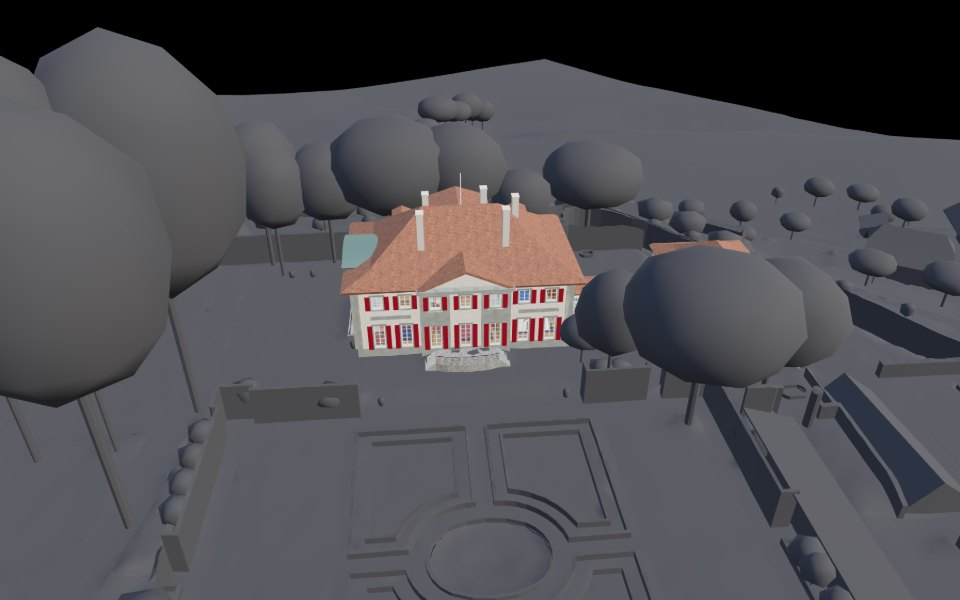

# Reconstructions

<p align="center">
  <a href="https://bbl-dres.github.io/reconstruction/">
    
  </a>
</p>

[](https://bbl-dres.github.io/reconstruction/)
[](LICENSE)

> [!WARNING]
> **This is an experiment.** The models are created by an LLM from publicly available data. They are not survey-grade and should not be relied on for measurements, planning or any official purpose.

Experimental 3D reconstructions of Swiss federal buildings, made from publicly available data.

The [gallery](https://bbl-dres.github.io/reconstruction/) shows each reconstruction as a card or on a map. All buildings share one viewer, and each lives in its own folder under `reconstructions/`.

## Preview

Live app: https://bbl-dres.github.io/reconstruction/

<p align="center">
  <a href="https://bbl-dres.github.io/reconstruction/reconstructions/bundeshaus/"></a>
  <a href="https://bbl-dres.github.io/reconstruction/reconstructions/von-wattenwyl-haus/"></a>
  <a href="https://bbl-dres.github.io/reconstruction/reconstructions/landgut-lohn/"></a>
</p>

## Repository layout

| Path | Content |
|---|---|
| `index.html`, `gallery/` | Gallery page and map |
| `viewer/` | Shared Three.js building viewer |
| `reconstructions/<id>/` | One folder per building; copy `_template/` to start a new one |
| `tools/` | Model pipeline, checks, reference catalog and local server |
| `docs/` | [Handbook](docs/handbook.md), [viewer guide](docs/viewer.md) and [sources](docs/sources.md) |
| `tests/` | Viewer, pipeline and configuration tests |

Each reconstruction has a committed **`public/`** folder (published) and a gitignored **`work/`** folder. See [Contributing](CONTRIBUTING.md) and the [handbook](docs/handbook.md) to add a building.

## Run locally

```sh
python tools/serve.py
```

Then open [localhost:8000](http://localhost:8000/).

## License

Project code: [MIT](LICENSE). Bundled dependencies and third-party material retain their respective licenses and terms; [THIRD_PARTY.md](THIRD_PARTY.md) lists the software and data sources. Map data © OpenStreetMap contributors, basemap © CARTO.